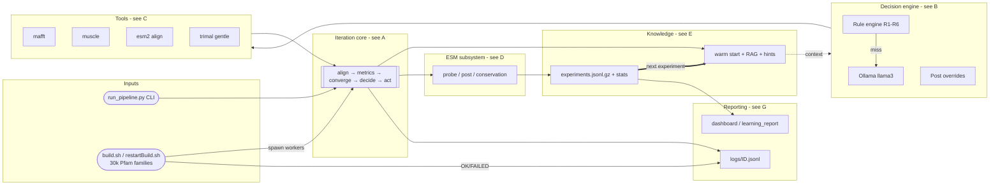
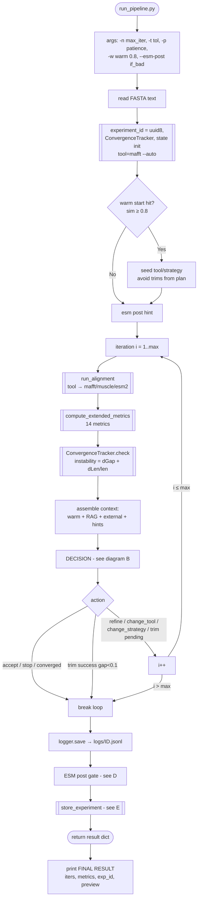
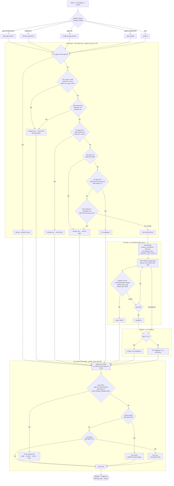
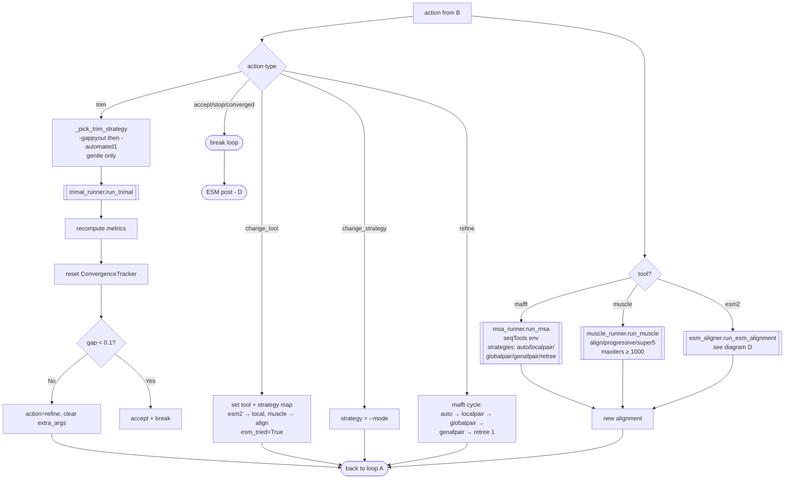
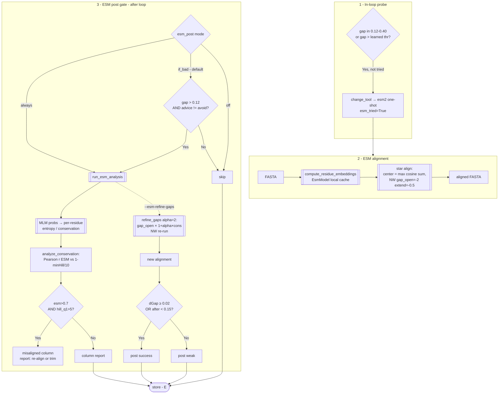
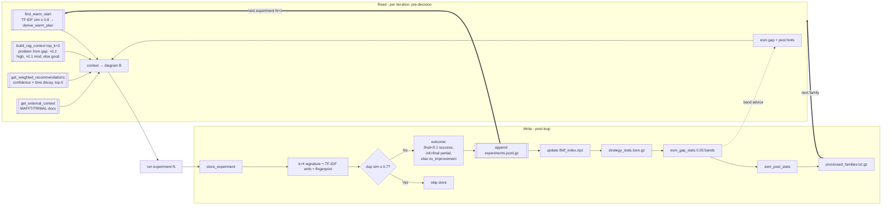
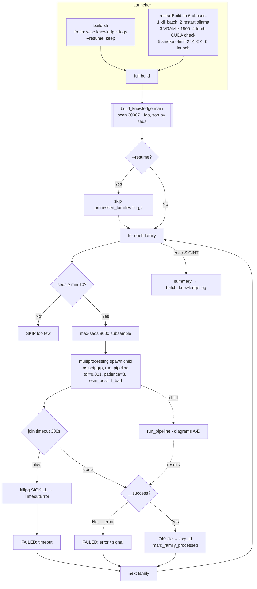
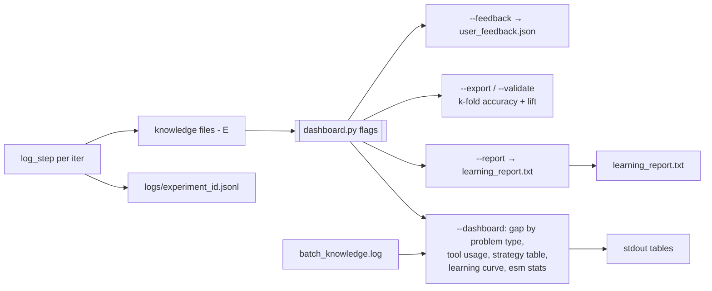

# MSA AI — Full Flowcharts

Complete map of how this AI works, split into **readable subsets**. Each diagram is self-contained; arrows between sections are shown in **Diagram 0**.

**Legend**

| Shape | Meaning |
|-------|---------|
| `([...])` | Entry / exit |
| `[[...]]` | Process step |
| `{...}` | Decision (threshold on edge) |
| `-->` | Main flow |
| `-.-` | Knowledge / context feed |
| `==>` | Outer cycle (next run / next family) |
| Subgraph | Module boundary |

| Color class | Meaning |
|-------------|---------|
| 🟦 tools | Alignment / trim execution |
| 🟨 decision | Rules, overrides, classify |
| 🟩 knowledge | RAG, stats, experiment store |
| 🟥 ESM | ESM-2 probe / align / post / analysis |
| 🟪 batch | Batch build / workers |

Primary files: `run_pipeline.py`, `scripts/pipeline_loop.py`, `scripts/ai_controller.py`, `scripts/extended_metrics.py`, `scripts/rag_retrieve.py`, `scripts/rag_store.py`, `scripts/build_knowledge.py`.

---

## Diagram 0 — Big picture



---

## A. Entry & iteration loop



**Exit conditions:** `accept` / `stop` / `converged` / trim-to-accept / `max_iterations` exhausted.

---

## B. Decision engine (full depth)

Per-iteration path: metrics → classify → **rules** → **LLM** → **fallback** → **overrides** → action.



### B — LLM rules & hard constraints (prompt, `ai_controller.py:89-103`)

| # | Condition | Action |
|---|-----------|--------|
| 1 | `gap > 0.15` and tool=mafft | change_tool → muscle |
| 2 | `gap > 0.15` and tool=muscle | trim `-gappyout` (gentle only) |
| 3 | `gap > 0.15` and tool=esm2 | trim `-gappyout` |
| 4 | `gap > 0.25` and `identity < 0.2` | change_tool → esm2 |
| 5 | `identity < 0.3` and `gap > 0.15` | change_tool → muscle |
| 6 | `gap < 0.1` and `sp > 0.5` | **accept** |
| 7 | `hill_q1_avg > 10` | consider esm2 |
| 8 | otherwise | refine |

**Hard constraints:** never accept if `gap > 0.15`; switch tool after 2 failures; trimal args only `-gappyout`/`-automated1` (never `-strict`/`-strictplus`/`-nogaps`).

### B — Validation pipeline (3 attempts)

```text
response JSON
  → _validate_action   (whitelist action/tool/msa_mode; bad → coerce refine/mafft)
  → _sanitize_extra_args (per-tool flag allowlist; trim → gappyout/automated1 only)
  → _check_metrics_echo  (echoed gap/sp/identity within 0.05 of actual)
  → fail: retry ≤ 3 → ValueError → fallback (FB)
```

### B — Fallback thresholds

| Condition | Result |
|-----------|--------|
| LLM exception / timeout / 3 invalid | `gap < 0.15` → **accept** (low conf) |
| else | **trim `-gappyout`** (low conf) |

---

## C. Tool execution & action dispatch



---

## D. ESM subsystem (4 paths)



**Notes**

- Learned ESM threshold: lowest 0.05-gap band with `n≥3` and success ≥50%, bands `lo≥0.10` only; default `(0.25, not learned)`.
- **No co-residue map:** decisions are per-column/per-position only; neighbors never cross-checked explicitly.
- Model: `models/models--facebook--esm2_t33_650M_UR50D` (local HF snapshot).

---

## E. Knowledge & RAG loop



**Dedup:** skip if near-duplicate (TF-IDF ≥ 0.7). **ESM band success:** `Δgap ≥ 0.02 OR after < 0.15`.

---

## F. Batch build



**Ops notes:** PID → `logs/batch_knowledge.pid`; log → `logs/batch_knowledge.log`. Known hang pattern: child stuck in CUDA → log silent; fix = kill + `restartBuild.sh --resume` (sidecar keeps progress).

---

## G. Reporting & outputs



**Key outputs**

| Output | Path |
|--------|------|
| Step logs | `logs/<experiment_id>.jsonl` |
| Experiments | `knowledge/experiments.jsonl.gz` |
| Stats | `knowledge/strategy_stats.toon.gz`, `esm_gap_stats.toon.gz`, `esm_post_stats.toon.gz` |
| Index | `knowledge/tfidf_index.npz`, `tfidf_index_vocab.json` |
| Batch | `logs/batch_knowledge.log`, `.pid`, `smoke_test.log` |
| Report | `learning_report.txt` |

---

## Cross-cutting cycles

| # | Cycle | Where |
|---|-------|-------|
| 1 | Iteration: metrics → decide → act → tool → log → metrics | A ⇄ B ⇄ C |
| 2 | Trim sub-cycle: trim → recompute → reset → accept or refine | C |
| 3 | Tool auto-switch: mafft → muscle → esm2 → mafft | B overrides |
| 4 | Learning across runs: store → next warm start / hints / LLM context | E ⇄ B |
| 5 | Batch: family → child pipeline → store → next family | F |
| 6 | ESM post overwrites last metrics before store (KB sees post gap) | D → E |

---

## File ↔ diagram index

| Diagram | Main files |
|---------|------------|
| 0 Big picture | all |
| A Entry & loop | `run_pipeline.py`, `scripts/pipeline_loop.py` |
| B Decision engine | `pipeline_loop.py` (rules/overrides), `ai_controller.py`, `llm_core.py` |
| C Tools | `msa_runner.py`, `muscle_runner.py`, `trimal_runner.py`, `esm_aligner.py`, `convergence.py` |
| D ESM | `esm_aligner.py`, `esm_analysis.py`, `protein_embeddings.py` |
| E Knowledge | `rag_store.py`, `rag_retrieve.py`, `rag_context.py`, `rag_advanced.py`, `knowledge_base.py`, `tfidf_sparse.py` |
| F Batch | `build.sh`, `restartBuild.sh`, `scripts/build_knowledge.py` |
| G Reporting | `dashboard.py`, `visualization.py`, `logger.py` |

Related: [ALIGNMENT_SCORING.md](ALIGNMENT_SCORING.md) — good/bad thresholds (Hill, Shannon, gap).
